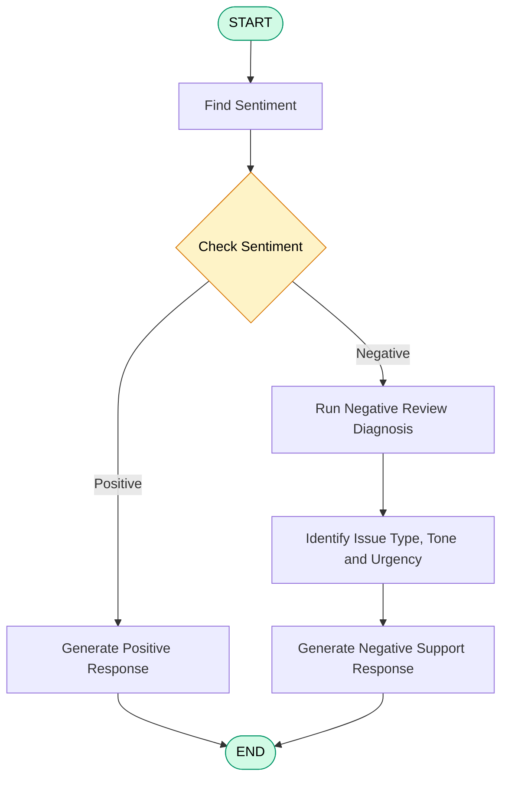

# 📝 Review Handling – LLM-Based Conditional Workflow

## 📌 Project Overview

This project demonstrates an **LLM-based Conditional Workflow using LangGraph** to automatically analyze customer reviews and generate appropriate responses based on their sentiment.

The workflow classifies customer reviews into positive or negative categories and follows different execution paths depending on the sentiment.

- **Positive Reviews:** Generates a warm thank-you message and encourages customers to share feedback on the website.
- **Negative Reviews:** Analyzes the customer's issue, identifies its category, emotional tone, and urgency, and generates an empathetic customer support response.

The workflow uses LangGraph for conditional execution and a locally hosted Qwen model for LLM-based processing.

## 🎯 Project Objectives

- Classify customer reviews using sentiment analysis.
- Implement conditional routing in LangGraph.
- Generate personalized responses for positive reviews.
- Diagnose negative reviews based on issue type, tone, and urgency.
- Generate empathetic responses for negative customer experiences.
- Understand how conditional workflows control LLM execution paths.

## 🏗️ Workflow Architecture

The workflow consists of four main nodes:

| Node | Description |
|---|---|
| `find_sentiment` | Analyzes the review and classifies it as positive or negative. |
| `positive_response` | Generates a warm thank-you message for positive reviews. |
| `run_diagnosis` | Analyzes negative reviews and identifies issue type, tone, and urgency. |
| `negative_response` | Generates an empathetic support response based on the diagnosis. |

## 🔄 Workflow Flowchart



### Workflow Execution

**1. Sentiment Classification**

The `find_sentiment` node analyzes the customer review and identifies its sentiment:

- Positive
- Negative

**2. Conditional Routing**

The `check_sentiment` function determines which execution path should be followed:

- If sentiment is positive → `positive_response`
- If sentiment is negative → `run_diagnosis`

**3. Positive Review Handling**

The `positive_response` node generates a customer-friendly thank-you message and encourages the customer to provide feedback on the website.

**4. Negative Review Diagnosis**

The `run_diagnosis` node identifies three important attributes:

| Attribute | Possible Values |
|---|---|
| Issue Type | UX, Performance, Bug, Support, Other |
| Tone | Angry, Frustrated, Disappointed, Calm |
| Urgency | Low, Medium, High |

**5. Negative Review Response**

The `negative_response` node uses the diagnosis results to generate an empathetic and helpful customer support message.

## 🛠️ Technologies & Libraries

- **Python** – Programming language
- **LangGraph** – Workflow orchestration and conditional routing
- **LangChain** – LLM integration
- **Hugging Face** – Local model integration
- **Qwen2.5-0.5B-Instruct** – Instruction-tuned language model
- **Pydantic** – Structured output validation
- **Regular Expressions (re)** – Extracting JSON results from model responses
- **python-dotenv** – Environment variable management

## 📂 Project Structure

```text
Review-Handling-Conditional-Workflow/
│
├── Review_Handling.ipynb
├── README.md
├── .env
└── .gitignore
```

## ⚙️ Installation & Setup

### 1. Clone the Repository

```bash
git clone <your-repository-url>
```

### 2. Navigate to the Project Directory

```bash
cd Review-Handling-Conditional-Workflow
```

### 3. Install Dependencies

```bash
pip install langgraph langchain langchain-huggingface pydantic python-dotenv transformers torch
```

### 4. Configure Environment Variables

Create a `.env` file if required:

```env
HUGGINGFACE_API_KEY=your_huggingface_token
```

Note: The local Qwen model can run without a Hugging Face API token if the model is already accessible locally or can be downloaded publicly.

### 5. Run the Notebook

Open `Review_Handling.ipynb` in Jupyter Notebook or VS Code and execute the cells.

## 🧪 Example Use Cases

### Example 1: Positive Review

**Input:**

```text
I've been using this app for about a month now.
The user interface is incredibly clean and intuitive.
Everything is exactly where you'd expect it to be.
Great job to the design team!
```

**Execution Path:**

```text
START → Find Sentiment → Positive
      → Positive Response → END
```

**Output:**

A warm thank-you message appreciating the customer's feedback and inviting them to share feedback on the website.

### Example 2: Negative Review

**Input:**

```text
I've been trying to log in for over an hour now,
and the app keeps freezing on the authentication screen.
I even tried reinstalling it, but no luck.
This kind of bug is unacceptable.
```

**Execution Path:**

```text
START → Find Sentiment → Negative
      → Run Diagnosis
      → Negative Response → END
```

**Diagnosis Output:**

```json
{
    "issue_type": "Bug",
    "tone": "frustrated",
    "urgent": "high"
}
```

**Response:**

An empathetic customer support message acknowledging the login problem, apologizing for the inconvenience, and suggesting further technical assistance.

## 📚 Key LangGraph Concepts Learned

- StateGraph
- START and END
- State Management using TypedDict
- Nodes and Edges
- Conditional Edges
- Conditional Routing
- LLM Integration
- Pydantic Schema Validation
- JSON Output Extraction
- Multi-step LLM Workflows

## 🚀 Learning Outcome

Through this project, I learned how to build an LLM-based conditional workflow using LangGraph, where the execution path dynamically changes based on the sentiment of customer reviews.

I also explored how LLMs can be used for sentiment classification, issue diagnosis, and automated customer response generation.

## 🎥 Learning Resource

This project was developed as part of my LangGraph learning journey.

[CampusX – Conditional Workflows in LangGraph](https://youtu.be/I-dvZqTz-Wc?si=yoLy0DX0hZ55eMkx)

---

**Built with Python, LangChain, LangGraph, and Hugging Face.**